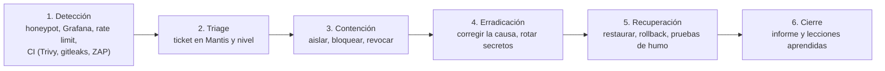

# Protocolo de respuesta ante incidentes de seguridad

Tarjeta SEC-02 (CARD-21) · Grupo 07 · Aplicación Rayuela Marketplace

Esta guía explica qué hacer cuando se detecta un incidente de seguridad en Rayuela: cómo se
detecta, cómo se clasifica, cómo se contiene, cómo se recupera el servicio y qué queda registrado.
Complementa a [`docs/procedimiento_rollback.md`](../procedimiento_rollback.md) (volver a una
versión estable) y al README (secretos, rate limiting, honeypot y Mantis).

## 1. Objetivo y alcance

Detectar, contener y recuperar la aplicación ante incidentes que afecten a la aplicación, la
base de datos, los contenedores, la infraestructura o los procesos automatizados (n8n), dejando
siempre un registro trazable en MantisBT.

Cubre, entre otros: acceso no autorizado, fuerza bruta contra el login, fuga de un secreto,
ransomware o pérdida de datos, un despliegue defectuoso y una vulnerabilidad nueva.

## 2. Roles

Son funciones, no personas: el grupo asigna los nombres en el tablero de trabajo.

| Rol | Responsabilidad |
|---|---|
| Coordinador del incidente (seguridad) | Recibe la alerta, clasifica el incidente, decide la contención y lleva el ticket en Mantis |
| Responsable de infraestructura y datos | Aísla servicios, restaura backups, ejecuta el rollback |
| Responsable de la aplicación | Prepara y revisa el arreglo (PR con los checks obligatorios) |
| Comunicación | Avisa al grupo y, si corresponde, al docente |

## 3. Clasificación

El coordinador asigna un nivel al abrir (o revisar) el ticket. Los tiempos son objetivos de
trabajo propuestos para el grupo, no compromisos medidos.

| Nivel | Cuándo | Prioridad en Mantis | Contener en | Resolver en |
|---|---|---|---|---|
| Crítico | Compromiso confirmado de datos, credenciales o servicios; ransomware | Inmediata | 1 hora | 24 horas |
| Alto | Honeypot con indicios de explotación previa; fuerza bruta sostenida; fuga de un secreto | Urgente | 4 horas | 3 días |
| Medio | Vulnerabilidad confirmada sin explotación; escaneo reiterado | Alta | 1 día hábil | Sprint |
| Bajo | Hallazgo informativo (cabeceras, versiones) | Normal | Sprint | Backlog |

## 4. Fases



## 5. Fuentes de detección

| Fuente | Qué avisa | Dónde se ve |
|---|---|---|
| Honeypot `/api/admin/reset-all` | Alguien exploró una ruta administrativa que no existe | Ticket automático `[HONEYPOT]` en Mantis (vía n8n), fila `HONEYPOT` en la tabla `auditorias` y métrica `rayuela_honeypot_hits_total` |
| Rate limiting | Muchos intentos fallidos de login, 2FA o chat (HTTP 429) | Métrica `rayuela_rate_limit_hits_total` en Prometheus/Grafana |
| Alertas de infraestructura | Servicio caído, recursos agotados, anomalías | Grafana → n8n → ticket en Mantis |
| Verificación de backups | El backup diario falló | Flujo de n8n con aviso por correo |
| Pipeline de CI | Dependencias o imagen vulnerables, secretos en commits, hallazgos de ZAP | Pestaña Actions de GitHub (Trivy, gitleaks y OWASP ZAP) |
| Registros de la aplicación | Accesos y acciones de los usuarios | Tablas `auditorias` e `historial_accesos` |

Consulta de los accesos al honeypot:

```bash
docker exec rayuela-db-primary sh -c 'PGPASSWORD=$(cat /run/secrets/db_password) psql -h 127.0.0.1 -U postgres -d postgres -c "select id, fecha, detalle from auditorias where accion = '"'"'HONEYPOT'"'"' order by id desc limit 20"'
```

## 6. Guías por escenario

### 6.1 Alerta del honeypot

1. Abrir el ticket `[HONEYPOT]`: trae la IP, el User-Agent, el método, la ruta y las cabeceras.
2. Buscar la misma IP en el log del backend y en `historial_accesos`, para ver si hizo algo más:
   `docker logs rayuela-backend-blue 2>&1 | grep honeypot`.
3. Si solo hubo exploración (un escáner): registrar en el ticket y cerrarlo.
4. Si la IP también tuvo accesos válidos o intentos de login: tratarlo como nivel **Alto**, bloquear la IP y
   continuar con el punto 6.2.

El honeypot **detecta y avisa, no bloquea**. El bloqueo de una IP se hace en el borde (por ejemplo con
una regla de IP en Cloudflare si el acceso es por el túnel). En nginx, `$remote_addr` es el salto
anterior (otro contenedor o el túnel), no el atacante, salvo que se configure `real_ip`; un `deny` por
esa dirección bloquearía a todos.

### 6.2 Fuerza bruta o robo de credenciales

- **Señal:** pico de `rayuela_rate_limit_hits_total` o de fallos en `historial_accesos`.
- **Contención:** bloquear las IPs de origen y forzar el cambio de contraseña de las cuentas afectadas.
- **Recuperación:** rotar la clave de firma de tokens, que cierra **todas** las sesiones abiertas:
  `node scripts/rotate-secrets.js jwt_secret --si`. Revisar `auditorias` en busca de acciones sospechosas
  hechas con las cuentas afectadas.

### 6.3 Fuga de un secreto

- **Señal:** aviso de gitleaks, o una clave visible en un repositorio, un log o una captura.
- **Contención:** **revocar primero en el proveedor** (Gemini, Mercado Pago, correo). Una clave filtrada
  se considera comprometida aunque se borre el commit.
- **Recuperación:**
  - Claves de terceros: pegar la clave nueva con `node scripts/rotate-secrets.js --poner <secreto> --si`.
  - Claves propias (`db_password`, `jwt_secret`, etc.): `node scripts/rotate-secrets.js <secreto> --si`.
  - Hacer una copia cifrada nueva de `secrets/` con `node scripts/backup-secrets.js respaldar <ruta fuera del repo>`.
  - Si la clave estuvo en el historial de Git, evaluar reescribir el historial y avisar al grupo.

Ver "Rotación de secretos" en el [README](../../README.md#rotación-de-secretos).

### 6.4 Ransomware o pérdida de datos

- **Señal:** archivos cifrados, base ilegible o servicios caídos sin causa.
- **Contención:** aislar el equipo (cortar la red y detener los contenedores con `docker compose stop`).
  No pagar ni reiniciar sin conservar evidencia: dejar intactos los volúmenes hasta analizarlos.
- **Recuperación:** restaurar el último backup válido **en una base nueva** y verificarla antes de
  apuntar la aplicación a ella:
  ```bash
  docker exec rayuela-backup ls -lh /backups
  docker exec rayuela-backup restore.sh /backups/<archivo>.sql.gz <base_nueva>
  ```
  El backup se hace una vez por día (03:00), así que se pierde como máximo el trabajo de las últimas 24 horas.
  Detalle y pruebas de humo en `docs/procedimiento_rollback.md` (nivel 4). La réplica de PostgreSQL **no
  sustituye al backup**: replica también los borrados y los cambios.

### 6.5 Despliegue defectuoso

- **Señal:** las pruebas de humo fallan después de publicar una versión.
- **Contención y recuperación:** conmutar al slot estable (blue/green) o redesplegar la imagen anterior,
  según `docs/procedimiento_rollback.md` (niveles 1 y 2), y repetir las pruebas de humo
  (`/api/health` = 200 y contrato de `/api/libros`).

### 6.6 Vulnerabilidad nueva

- **Señal:** alerta de ZAP o Trivy, o un reporte externo.
- **Acción:** registrar en Mantis con severidad y pasos de reproducción; corregir con un PR que pase los
  checks obligatorios; repetir el escaneo para confirmar que desapareció.

## 7. Cierre de todo incidente

Se completa el ticket de Mantis con:

1. **Cronología:** cuándo se detectó, quién lo vio, qué se hizo y cuándo se contuvo.
2. **Causa raíz:** por qué pasó.
3. **Acciones:** qué se hizo para contener, corregir y recuperar.
4. **Pendiente:** qué quedó sin resolver.
5. **Control nuevo:** qué cambio evitaría que se repita (se convierte en una tarjeta o un PR).

## 8. Práctica

El flujo del honeypot (detección, registro y ticket automático) sirve como simulacro de las fases 1 y 2:

```bash
curl -i -X POST http://localhost/api/admin/reset-all
```

Debe responder `401`, dejar una fila `HONEYPOT` en `auditorias` y crear un ticket en Mantis. Conviene
repetir el simulacro al cierre de cada sprint y revisar este documento si cambia la arquitectura.
